<div align="center">


# Codycube

**Cliente de Kubernetes de escritorio que te enseña cómo se comunican tus microservicios.**

Carga tus kubeconfig, mira cada recurso en vivo (también los CRD), administra el clúster sin escribir YAML<br/>
y ve el tráfico real entre servicios, con tasas, errores y latencias medidos por los sidecars de Dapr.


[Características](#-características) · [Empezar](#-empezar) · [Pruebas](#-pruebas) · [Arquitectura](#️-arquitectura) · [Documentación](#-documentación)

</div>


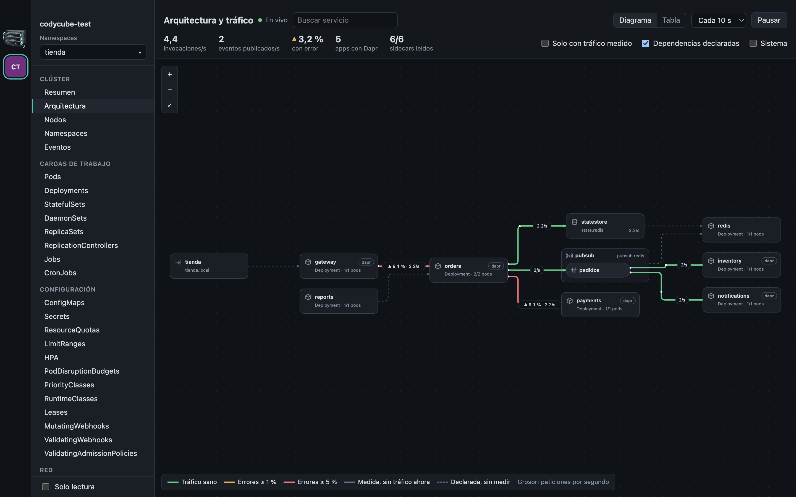

<sub>Las capturas usan un clúster k3s desechable con una tienda de demostración de seis microservicios (cinco con Dapr) y se regeneran con `node scripts/capturas.mjs`.</sub>

## ✨ Por qué Codycube

| | |
|---|---|
| 🛰️ **Ve la comunicación real** | Diagrama en vivo de quién llama a quién, cuánto y con qué errores, leído de los sidecars de Dapr. Sin instalar Prometheus. |
| 🧭 **Declarado frente a medido** | Lo que dicen los objetos (Ingress, selectores, variables, componentes) y lo que pasa de verdad se dibujan distinto. Nunca presenta una suposición como un hecho. |
| 🔑 **Administra sin YAML** | Secrets y ConfigMaps por claves, credenciales de registro, imágenes, etiquetas, taints, despliegues pausados. |
| 🤝 **No pisa el trabajo ajeno** | Cada edición se guarda con la `resourceVersion` que viste: si alguien cambió el objeto, da conflicto en lugar de sobrescribir. |
| ☸️ **Todo el clúster** | Cada tipo que sirve el API server, también los CRD con sus columnas, en tablas que se actualizan solas. |
| 🔒 **Seguro por diseño** | Interfaz sin Node y con CSP estricta, credenciales solo en el proceso principal, modo solo lectura y autorización de plugins `exec`. |

## 🚀 Características

### Arquitectura y tráfico entre microservicios

- **Arquitectura declarada:** Ingress, Services, cargas de trabajo, componentes de Dapr con sus temas dentro del broker, suscripciones y dependencias deducidas de variables de entorno (se muestra el nombre de la variable, nunca su valor).
- **Tráfico medido** en los sidecars de Dapr: invocaciones, publicación y entrega por tema, estado y bindings. Por conexión: tasa, % de error, latencia p50/p95, acumulados y desglose por resultado (`HTTP 200`, `HTTP 503`, `Reintento`…).
- **Destinos caídos:** las llamadas que Dapr no llegó a enviar aparecen como **No entregadas**, aunque no cuenten en sus métricas de invocación.
- Grosor = peticiones por segundo; color = errores (≥ 1 % ámbar, ≥ 5 % rojo); continuo = medido; discontinuo = solo declarado.
- Disposición automática por capas con ELK, plegado de los Services de una sola carga, pan y zoom, búsqueda, filtros y vista en tabla.
- Lecturas `GET` a través del API server (`pods/proxy`) solo mientras la vista está abierta. Funciona en modo solo lectura.

<table>
  <tr>
    <td width="50%">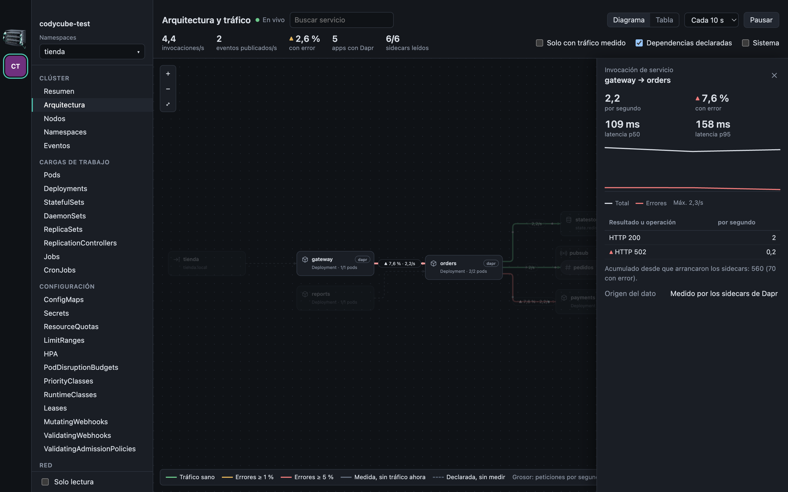</td>
    <td width="50%">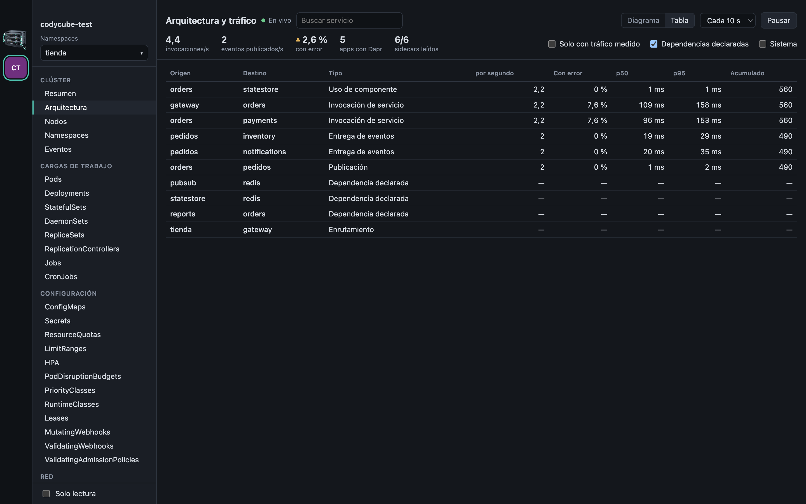</td>
  </tr>
  <tr>
    <td align="center"><sub>Detalle de una conexión</sub></td>
    <td align="center"><sub>Las mismas cifras en tabla</sub></td>
  </tr>
</table>

### Secrets y ConfigMaps sin YAML ni base64

- Editor por claves: valores multilínea, añadir, renombrar y quitar, cargar un valor desde archivo, importar un `.env` y copiar.
- Los Secrets se editan **descodificados**, ocultos hasta pedirlos, y se guardan en base64; los valores binarios se conservan intactos.
- Antes de guardar enseña qué claves se añaden, cambian y eliminan (nunca los valores).
- **«Usado por»:** qué cargas leen el objeto y cómo (variable, volumen, `envFrom`, `imagePullSecrets`). Tras guardar ofrece reiniciarlas; viene marcado si lo usan como variables, que solo se leen al arrancar.
- **Crear** con formularios: Secret genérico, credenciales de registro de imágenes (genera el `.dockerconfigjson`), TLS, usuario y contraseña o clave SSH, con las claves que exige cada tipo y la opción de crearlo inmutable.

<table>
  <tr>
    <td width="50%">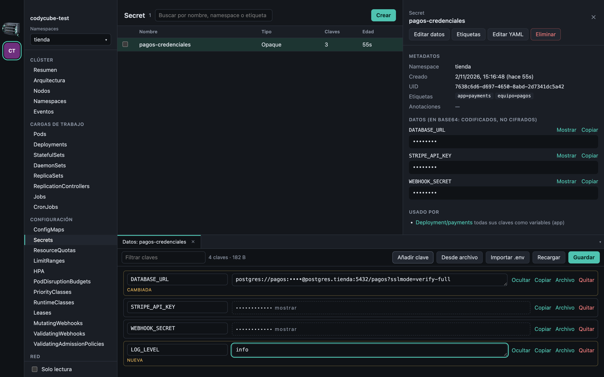</td>
    <td width="50%">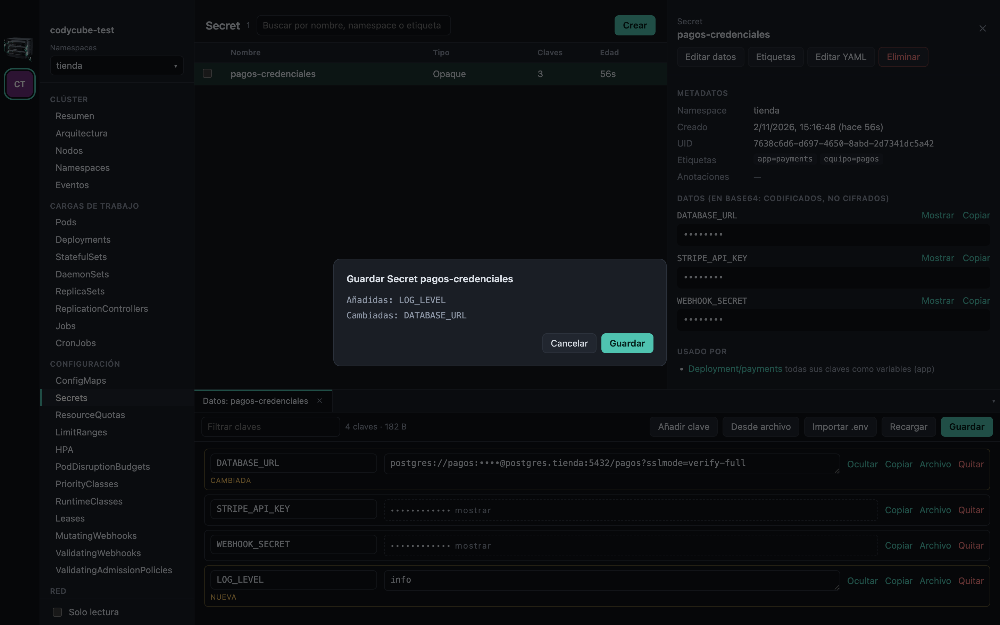</td>
  </tr>
  <tr>
    <td width="50%">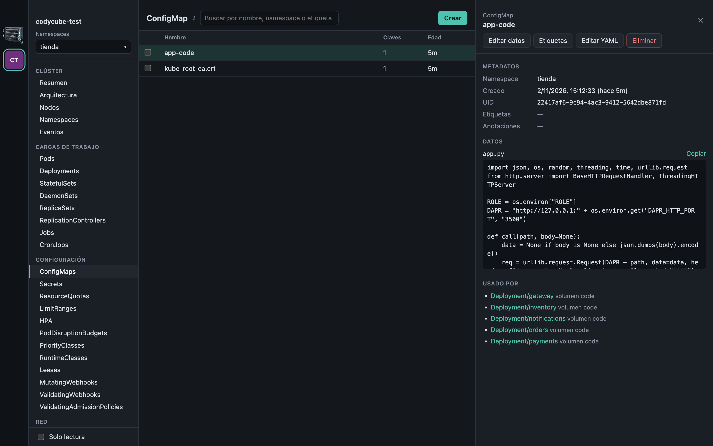</td>
    <td width="50%">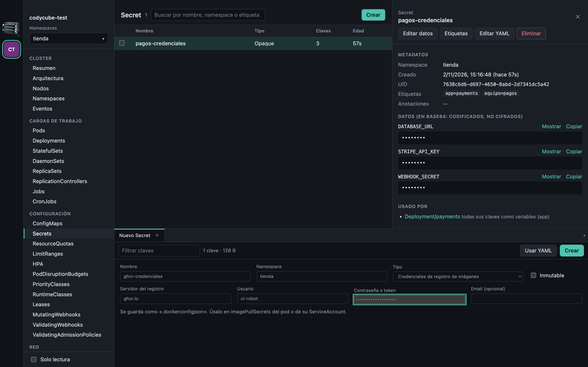</td>
  </tr>
</table>

### Recursos en vivo

- Una tabla en vivo por cada tipo que sirve el clúster, incluidos los **CRD** con sus `additionalPrinterColumns`.
- **Filtro de varios namespaces** con búsqueda y «solo» para pasar de uno a otro, aplicado a tablas, resumen, Helm y arquitectura. Como la API no admite varios namespaces en una petición, se abre una lista por cada uno y se unen: basta con tener permiso en esos namespaces.
- Búsqueda por nombre o etiqueta, orden por columna y eliminación múltiple.
- Secciones: resumen, nodos, namespaces, eventos, cargas de trabajo, configuración, red, almacenamiento, control de acceso, Helm y recursos personalizados.
- **Resumen del clúster:** nodos y pods, CPU y memoria reservadas, consumo real si hay metrics-server, pods con problemas y advertencias recientes.

<table>
  <tr>
    <td width="50%">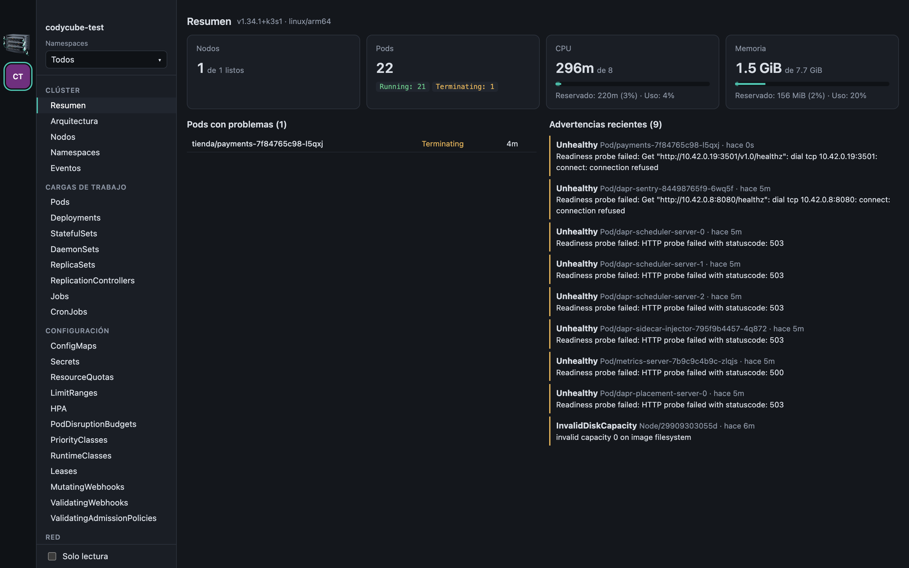</td>
    <td width="50%">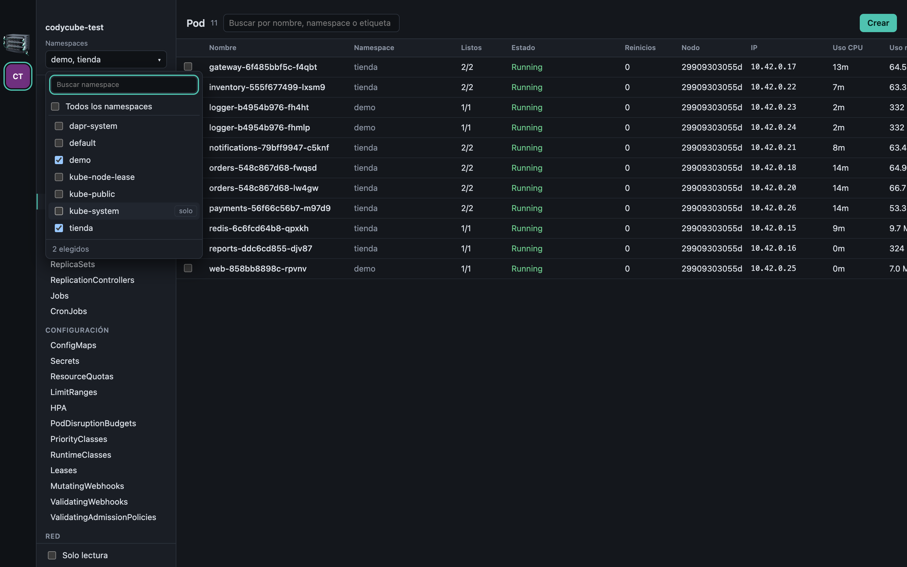</td>
  </tr>
</table>

### Registros, terminal y YAML

- **Registros en vivo** por pod o combinados de un Deployment, StatefulSet, DaemonSet, Job, CronJob o Service: selector de contenedor, ejecución anterior, filtro, marcas de hora y descarga.
- **Terminal** en el contenedor sobre WebSocket (`v4.channel.k8s.io`): bash si existe, si no sh. No necesita `kubectl`.
- **Reenvío de puertos** de pods y Services, escuchando solo en `127.0.0.1`.
- **YAML**: ver, editar con detección de conflictos, crear desde plantilla y aplicar varios documentos con **Simular** antes.

<table>
  <tr>
    <td width="50%">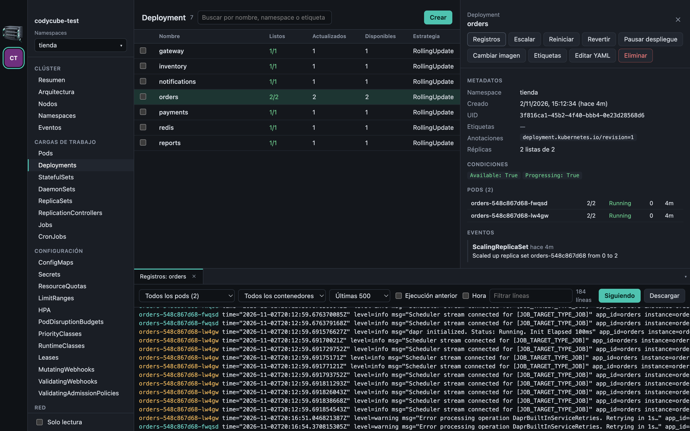</td>
    <td width="50%">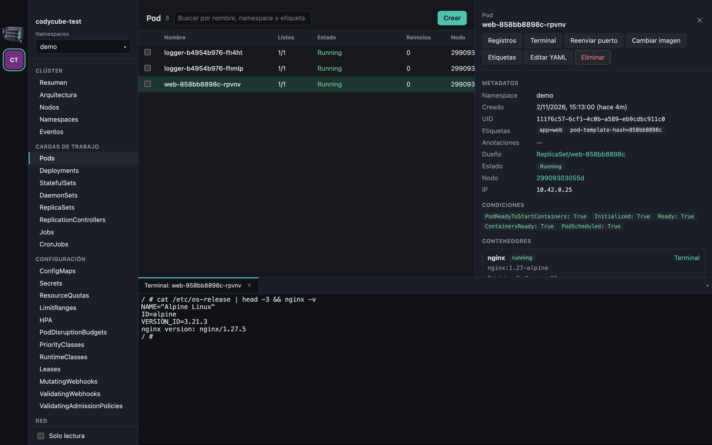</td>
  </tr>
</table>

### Operar el clúster

| Sobre | Acción |
| --- | --- |
| Cualquier recurso | Ver y editar YAML, crear, editar etiquetas y anotaciones sin YAML, eliminar |
| Pods | Registros, terminal, reenvío de puertos, cambiar imagen, forzar eliminación |
| Deployments, StatefulSets, ReplicaSets | Escalar |
| Deployments, StatefulSets, DaemonSets, CronJobs | Cambiar la imagen de cada contenedor, como `kubectl set image` |
| Deployments, StatefulSets, DaemonSets | Reinicio progresivo |
| Deployments | Revertir a una revisión, pausar y reanudar el despliegue |
| Nodos | Acordonar, habilitar, drenar (respeta los PodDisruptionBudget) y editar taints |
| CronJobs | Suspender, reanudar y ejecutar ahora |
| Services | Registros y reenvío de puertos |
| Helm (con la CLI `helm`) | Listar, instalar o actualizar, valores, manifiesto, historial, revertir y desinstalar |

<table>
  <tr>
    <td width="50%">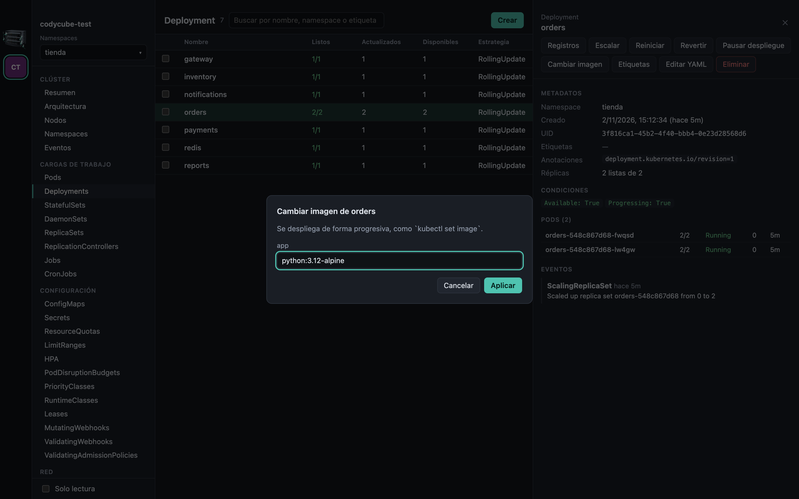</td>
    <td width="50%">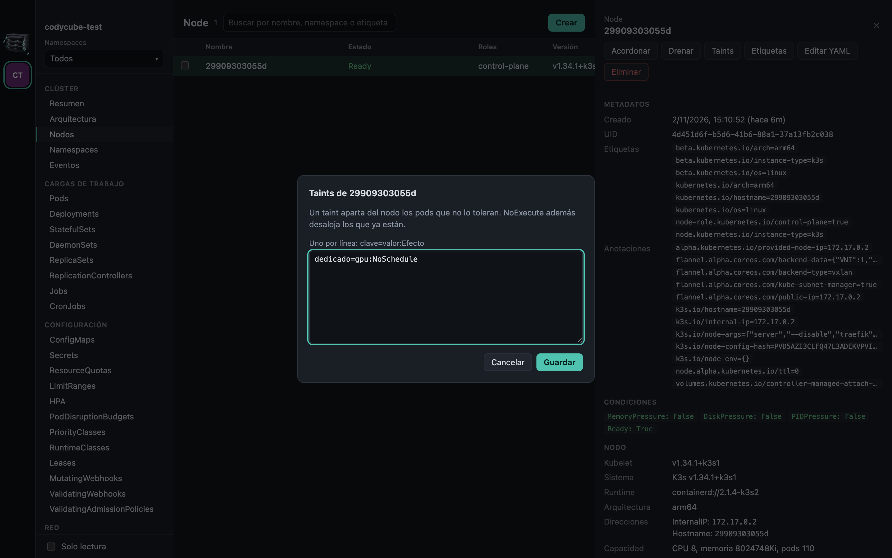</td>
  </tr>
  <tr>
    <td width="50%">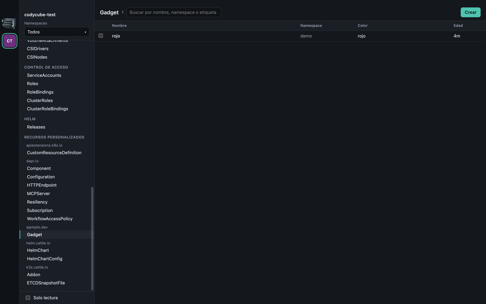</td>
    <td width="50%">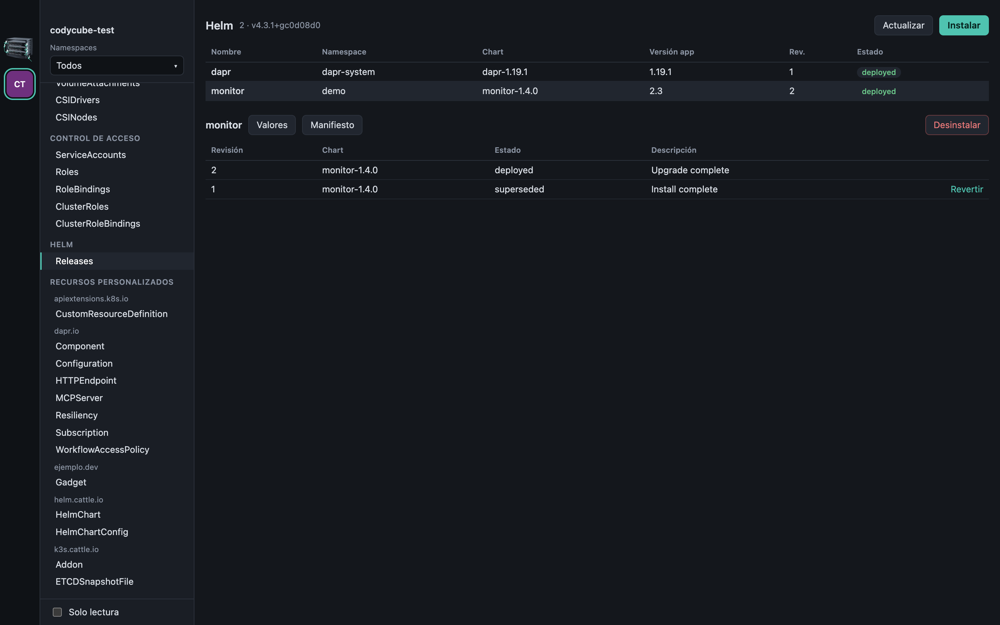</td>
  </tr>
</table>

### Clústeres

- Varios kubeconfig y varios clústeres abiertos a la vez. Al primer arranque detecta `$KUBECONFIG` o `~/.kube/config`; se añaden más con **Cargar kubeconfig**, **Pegar texto** o soltando el archivo.
- Los archivos no se modifican y, si cambian en disco (por ejemplo, tras `gcloud … get-credentials`), la lista se actualiza sola.
- Autenticación por token, certificado o plugin `exec` (con autorización explícita del comando).
- **Modo solo lectura** por clúster, aplicado en el proceso principal: ninguna ruta de la interfaz puede saltárselo.

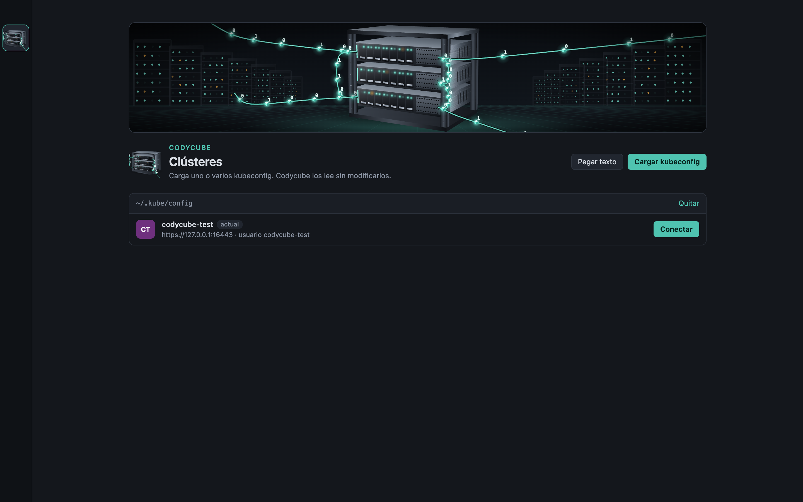

## 🏁 Empezar

Requisitos: **Node 22+**. Opcional: `helm` para la sección de Helm; Docker y `kubectl` para las pruebas de extremo a extremo.

```bash
git clone https://github.com/godie007/codycube.git
cd codycube
npm install
npm run dev
```

| Comando | Qué hace |
|---|---|
| `npm run dev` | App con recarga en caliente |
| `npm run build` | Compila main, preload y renderer en `out/` |
| `npm start` | Abre la versión compilada |
| `npm test` | Pruebas unitarias con vitest, sin clúster |
| `npm run typecheck` | TypeScript estricto en los dos proyectos (node y web) |
| `npm run install:mac` | Genera `Codycube.app` y la instala en `/Applications` |
| `npm run package:mac` | Solo genera `dist/Codycube.app` |

### Instalar en macOS

```bash
npm run install:mac
```

Genera la app (nombre, icono y firma ad hoc) a partir del Electron de `node_modules`, sin instalar nada más, y la deja en `/Applications`. Una app abierta desde Finder no hereda el `PATH` de la terminal: Codycube lo lee de tu shell de inicio para encontrar `gcloud`, `aws`, `kubelogin` o `helm`. La firma es ad hoc: vale para tu Mac; para repartirla haría falta firmarla con un certificado de Apple y notarizarla.

## 🧪 Pruebas

```bash
npm run typecheck
npm test     # 53 unitarias, sin clúster
```

Las pruebas de extremo a extremo manejan la **app real** con Playwright y **se niegan a correr salvo que el contexto actual se llame `codycube-test`**, para no tocar nunca un clúster de verdad.

<details>
<summary><strong>Clúster desechable con k3s, Dapr y la demo</strong></summary>

```bash
docker run -d --name codycube-test --privileged -p 127.0.0.1:16443:6443 \
  --tmpfs /run --tmpfs /var/run rancher/k3s:latest server --disable traefik \
  --tls-san 127.0.0.1 --write-kubeconfig-mode 644
docker exec codycube-test cat /etc/rancher/k3s/k3s.yaml \
  | sed 's#https://127.0.0.1:6443#https://127.0.0.1:16443#; s/: default$/: codycube-test/' > /tmp/test.yaml
export KUBECONFIG=/tmp/test.yaml
kubectl apply -f tests/fixtures.yaml
printf 'apiVersion: ejemplo.dev/v1\nkind: Gadget\nmetadata: { name: rojo, namespace: demo }\nspec: { color: rojo }\n' | kubectl apply -f -

helm install dapr dapr --repo https://dapr.github.io/helm-charts/ -n dapr-system --create-namespace --wait
kubectl apply -f tests/dapr-demo.yaml
```

Para borrarlo: `docker rm -f codycube-test`.

</details>

| Suite | Pasos | Qué cubre |
|---|---|---|
| `tests/e2e-architecture.mjs` | 15 | Topología, tráfico real en todos los caminos, % de error, inspector, tabla frente a los contadores del sidecar, filtros, destino caído, sin permiso `pods/proxy` |
| `tests/e2e-admin.mjs` | 11 | «Usado por», editor de ConfigMap y Secret, `.env`, conflictos, binarios intactos, Secret de registro, inmutables, etiquetas, imagen, pausa, taints, solo lectura |
| `tests/e2e-responsive.mjs` | 29 | Sin desbordamientos ni recortes de 960 × 600 a 1920 × 1080 |
| `tests/e2e.mjs` | 32 | Seguridad de la ventana, kubeconfig, secciones, tablas en vivo, logs, escalar, revertir, terminal, puertos, YAML, CronJob, CRD, drenado, solo lectura |
| `tests/smoke-packaged.mjs` | — | La app empaquetada arranca y una tabla se recupera si el API server se reinicia |

```bash
npx electron-vite build
node tests/e2e-architecture.mjs && node tests/e2e-admin.mjs && node tests/e2e-responsive.mjs
node tests/e2e.mjs        # al final: drena el nodo. Requiere helm
npm run package:mac && node tests/smoke-packaged.mjs
```

> Para correr `tests/e2e.mjs` con Dapr instalado, borra antes el `PodDisruptionBudget` de `dapr-system`: el del scheduler no admite desalojos y el drenado agota sus reintentos. Después, `kubectl -n tienda rollout restart deploy` devuelve los sidecars a la demo.

**Capturas.** Las imágenes de este README y de la documentación salen de `node scripts/capturas.mjs` contra el mismo clúster: crea objetos de ejemplo, recorre la app a 1440 × 900 y lo deja todo como estaba.

## 🏗️ Arquitectura

```
┌──────────────────────────────┐  un canal IPC   ┌───────────────────────────────────┐        ┌──────────────┐
│ Renderer (React)             │ ──────────────▶ │ Main (Electron / Node)            │ HTTPS  │  API server  │
│ sin Node, sandbox, CSP       │  codycube:api   │ lista cerrada de handlers         │ ─────▶ │  Kubernetes  │
│ components/ · lib/           │ ◀────────────── │ KubeClient · watch · streams      │  WS    │              │
│                              │  watch · logs · │ topology · traffic · helm (CLI)   │ ◀───── │ pods/proxy → │
│                              │  traffic …      │ credenciales y modo solo lectura  │        │ sidecar Dapr │
└──────────────────────────────┘                 └───────────────────────────────────┘        └──────────────┘
```

```
src/main/       Proceso principal: único que ve credenciales y red
  kubeconfig.ts   Archivos cargados, contextos, autorización de exec, solo lectura
  kube-client.ts  REST, flujos y WebSocket autenticados; descubrimiento de tipos
  watch.ts        list + watch, lotes de eventos, relistado y reconexión
  actions.ts      Aplicar, editar, escalar, reiniciar, revertir, drenar, datos, imagen, taints…
  streams.ts      Registros, terminal y reenvío de puertos
  helm.ts         CLI de helm, sin shell y con valores por stdin
  topology.ts     Arquitectura declarada a partir de los objetos del clúster
  prometheus.ts   Formato de métricas, contadores y percentiles
  traffic.ts      Lectura de sidecars y tasas por conexión
src/preload/    Puente mínimo hacia la interfaz (contextBridge)
src/shared/     Contrato tipado de la API interna
src/renderer/   Interfaz en React: components/ (vistas) y lib/ (catálogo, datos, filtros y disposición del grafo)
scripts/        Empaquetado, marca y capturas
tests/          Unitarias, extremo a extremo y manifiestos de prueba
codycube-obsidian/  Documentación completa (bóveda de Obsidian) y capturas
```

**Seguridad.** El renderer no tiene Node ni acceso a la red del clúster y solo llama métodos de una lista cerrada, con el origen comprobado en cada llamada. Las credenciales viven en el proceso principal; los kubeconfig no se copian. Los plugins `exec` necesitan autorización del comando concreto. El modo solo lectura se aplica en el proceso principal (también a la terminal). Helm se ejecuta sin shell y recibe los valores por stdin.

### Comportamientos a tener en cuenta

- **Aplicar YAML usa server-side apply con `force`**, como `kubectl apply --server-side --force-conflicts`: toma posesión de los campos que indiques. Usa **Simular** antes.
- **Editar YAML usa `PUT`** con `resourceVersion`: si alguien cambió el objeto, da conflicto en vez de pisarlo.
- **Editar el YAML de un Secret lo muestra en claro** (en base64), porque abrirlo es pedir verlo. La anotación `last-applied-configuration` se oculta en los detalles, pero sí aparece en ese YAML.
- **Reenvío de puertos de un Service:** apunta a un único pod listo elegido al iniciar, igual que `kubectl port-forward`.
- **Tráfico:** se mide lo que pasa por los sidecars de Dapr; la comunicación directa sin Dapr solo aparece como dependencia declarada, e Istio y Linkerd no están soportados. Las métricas comprobadas son las de Dapr 1.19.
- **Registros:** si un contenedor se reinicia, el flujo termina y aparece **Reanudar**. Se conservan las últimas 50 000 líneas por pestaña.

### Marca

El logo y la imagen son SVG animados con CSS, generados desde un modelo geométrico del rack proyectado en perspectiva. Se cargan como ``, así que no ejecutan código, y respetan `prefers-reduced-motion`.

```bash
node scripts/brand.mjs         # src/renderer/src/assets/cluster-*.svg y resources/icon.svg
npx electron scripts/icon.cjs  # resources/icon.png, del que sale el icono de la app
```

## 📚 Documentación

La documentación técnica completa vive en la bóveda de Obsidian [`codycube-obsidian/`](codycube-obsidian/00%20-%20Inicio.md): arquitectura y seguridad, acceso al clúster, algoritmos (topología, tráfico de Dapr, disposición del diagrama, concurrencia), interfaz, flujos de trabajo paso a paso, pruebas, glosario y registro de decisiones. Ábrela en Obsidian con *Abrir carpeta como bóveda* y empieza por `00 - Inicio`.

Cómo se estudió el funcionamiento de un cliente tipo Lens (sobre Freelens, MIT, porque la licencia de Lens prohíbe la ingeniería inversa) y qué se decidió distinto: [Estudio de Freelens](codycube-obsidian/01%20-%20Arquitectura/Estudio%20de%20Freelens.md).

## 🗺️ Hoja de ruta

- [x] Varios kubeconfig y clústeres, plugins `exec`, modo solo lectura
- [x] Tablas en vivo para todos los tipos y CRD, filtro de varios namespaces
- [x] Registros, terminal y reenvío de puertos sin `kubectl`
- [x] Arquitectura declarada y tráfico real desde Dapr
- [x] Secrets y ConfigMaps sin YAML, «Usado por», imagen, etiquetas, taints, pausa
- [x] Helm
- [x] App de macOS instalable (`npm run install:mac`)
- [ ] Firma con Developer ID y notarización
- [ ] Empaquetado para Linux y Windows
- [ ] Gráficas históricas con Prometheus
- [ ] Tráfico de Istio y Linkerd
- [ ] Shell en nodos y terminal local con `kubectl`
- [ ] Formularios para RBAC
