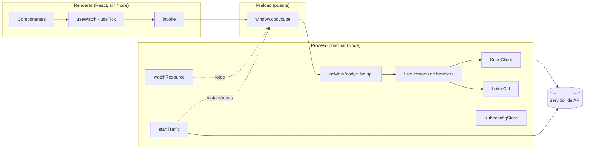

# 🗺️ Visión General

Codycube es una app de escritorio para **administrar clústeres de Kubernetes**: lee los kubeconfig del equipo, muestra en vivo cualquier tipo de recurso que sirva el clúster (incluidos los personalizados), ofrece las acciones habituales sin escribir YAML y dibuja **la arquitectura y el tráfico entre microservicios** a partir de los sidecars de Dapr.

## 🧩 Piezas

| Capa | Carpeta | Responsabilidad |
|---|---|---|
| Proceso principal | `src/main/` | Único proceso con credenciales. Habla con el servidor de API, ejecuta `helm`, mantiene listas en vivo, terminales, reenvíos y sesiones de tráfico |
| Preload | `src/preload/` | Expone `window.codycube` con `invoke` y suscripciones a canales de empuje |
| Compartido | `src/shared/types.ts` | Contrato de la API (`Api`), tipos de recursos, mensajes de watch, logs, tráfico |
| Renderer | `src/renderer/src/` | React 19: vistas en `components/`, lógica pura en `lib/` (catálogo, formato, filtros y disposición del diagrama, datos de ConfigMaps y Secrets) |

## 🔄 Recorrido de un dato

1. La tabla de Pods llama a `useWatch(contextId, resource, namespaces)`.
2. `useWatch` invoca `resource:watch` una vez por namespace elegido (o una sola para todos). Ver [[03 - Algoritmos/Varios Namespaces|Varios namespaces]].
3. El proceso principal hace `GET …/pods` (list) y abre `GET …/pods?watch=1&resourceVersion=…`. Ver [[02 - Acceso al Clúster/Listas en Vivo|Listas en vivo]].
4. Los eventos se agrupan en lotes y llegan al renderer por `codycube:watch`.
5. `applyWatchEvents` actualiza la lista y React repinta solo lo que cambió.

Las escrituras siguen el camino inverso: un botón llama a `invoke('resource:set-data', …)`, el handler pasa por `writable()` (que aplica el **modo solo lectura** en el proceso principal) y el `KubeClient` hace la petición.

## 🧱 Principios

- **Una sola vía al clúster.** Todo pasa por `KubeClient` sobre REST, así los CRD funcionan igual que los tipos nativos.
- **La interfaz no tiene credenciales.** El renderer no tiene Node ni acceso a la red del clúster.
- **No pisar el trabajo ajeno.** Las ediciones usan `resourceVersion`; un cambio concurrente da conflicto. Ver [[03 - Algoritmos/Edición con Control de Concurrencia|Edición con control de concurrencia]].
- **Decir de dónde sale cada dato.** En la arquitectura, lo *declarado* (objetos) y lo *medido* (sidecars) se dibujan distinto.
