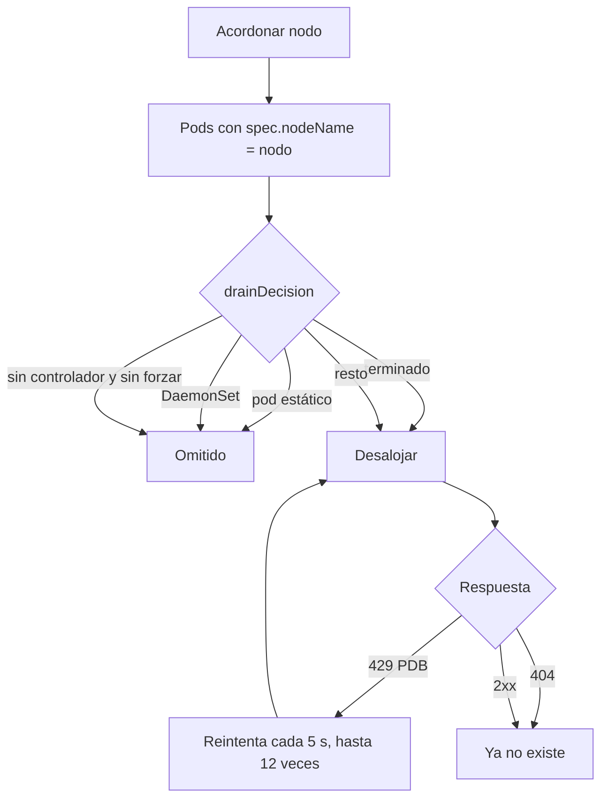

# ✍️ Acciones de Escritura

Código: `src/main/actions.ts`. Todas pasan por `writable(contextId)` (modo solo lectura) y se identifican con `fieldManager=codycube`.

| Acción | Petición | Notas |
|---|---|---|
| Editar YAML | `PUT` con la `resourceVersion` del YAML | No permite cambiar nombre ni namespace; un documento por edición |
| Aplicar YAML | Server-side apply (`PATCH application/apply-patch+yaml`, `force=true`) por documento | **Simular** usa `dryRun=All`. Sin nombre (`generateName`) se hace `POST` |
| Crear | `POST` | Falla con «Ya existe un X llamado Y» en lugar de sobrescribir |
| Eliminar | `DELETE`, con `propagationPolicy` opcional; forzar usa `gracePeriodSeconds=0` | Eliminación múltiple desde la tabla |
| Escalar | `PATCH` merge sobre `/scale` (entero ≥ 0) | Deployments, StatefulSets, ReplicaSets |
| Reiniciar | `PATCH` de la anotación `kubectl.kubernetes.io/restartedAt` en la plantilla | Igual que `kubectl rollout restart` |
| Revertir | JSON Patch que sustituye `spec.template` por la del ReplicaSet de esa revisión (sin `pod-template-hash`) | Igual que `kubectl rollout undo --to-revision` |
| Pausar / reanudar | `PATCH` merge de `spec.paused` | |
| Cambiar imagen | `PATCH` estratégico identificando cada contenedor por nombre | Pod, Deployment, StatefulSet, DaemonSet, CronJob; también contenedores init |
| Datos de ConfigMap/Secret | `editObject` → `PUT` | Claves validadas (`[-._a-zA-Z0-9]`, ≤ 253, sin repetir), base64 válido, rechaza inmutables y borra `stringData` |
| Etiquetas y anotaciones | `editObject` → `PUT` | |
| Taints | `editObject` → `PUT` sobre el Node | Conserva `timeAdded` de los que siguen; efecto validado |
| Acordonar | `PATCH` de `spec.unschedulable` | |
| Drenar | Acordona y desaloja con la API `Eviction` | Ver abajo |
| CronJob | `PATCH` de `spec.suspend`; **Ejecutar ahora** crea un Job desde `jobTemplate` con `ownerReference` | |

## Drenado

El informe (`DrainReport`) separa desalojados, omitidos con su motivo y fallidos con su error.

## «Usado por»

`configUsers` busca en Deployments, StatefulSets, DaemonSets y CronJobs del namespace qué cargas leen un ConfigMap o Secret, y cómo (`configReferences`): volúmenes, fuentes proyectadas, `env.valueFrom`, `envFrom` e `imagePullSecrets`. Un CronJob se lista pero no se reinicia: su próxima ejecución ya leerá el valor nuevo.
