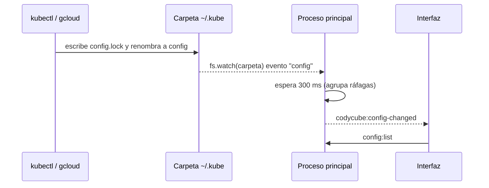

# 🗂️ Kubeconfig y Contextos

Código: `src/main/kubeconfig.ts` (`KubeconfigStore`) y `watchConfigFiles()` en `src/main/index.ts`.

## Qué se carga

| Origen | Cómo |
|---|---|
| Primer arranque | `defaultKubeconfigPaths()`: cada ruta de `$KUBECONFIG` (separadas por `:`) o, si no hay, `~/.kube/config` |
| **Cargar kubeconfig** | Diálogo de archivo. Se guarda la **ruta**, no el contenido |
| Soltar un archivo | Igual que cargarlo |
| **Pegar texto** | Se valida y se escribe en la carpeta de datos de la app, con permisos solo para el usuario |

El estado persistente (`state.json` en `userData`) tiene solo esto:

```ts
interface StoredState {
  files: string[]          // rutas de kubeconfig
  trustedExec: string[]    // "<contexto>|<comando>" autorizados
  readOnly: string[]       // contextos en solo lectura
  initialized: boolean
}
```

## Identidad de un contexto

- `fileIdOf(path)` = los 12 primeros caracteres del SHA-256 de la ruta.
- El id de un contexto es `<fileId>/<nombre del contexto>`. Dos archivos con un contexto llamado igual (`default`, muy habitual en k3s) no se confunden.

## Vigilancia de cambios



> [!tip] Por qué se vigila la carpeta
> kubectl y gcloud reemplazan el kubeconfig **renombrando** un archivo nuevo. Un watcher puesto sobre el archivo original queda apuntando a un inodo que ya no existe; vigilando la carpeta y filtrando por nombre, el cambio siempre se ve.

## Plugins `exec`

Si el usuario del contexto tiene `exec.command` (gcloud, aws, kubelogin…), el contexto aparece con `execTrusted: false` hasta que se autoriza. `configFor()` se niega a construir la configuración sin esa autorización: `Falta autorizar el comando de autenticación «gke-gcloud-auth-plugin»`.

Una app abierta desde Finder no hereda el `PATH` de la terminal. `inheritShellPath()` lo lee de la shell de inicio del usuario al arrancar para que esos comandos (y `helm`) se encuentren.
