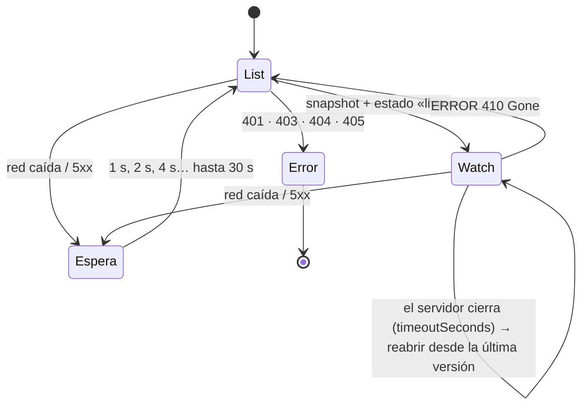

# 📡 Listas en Vivo

Código: `src/main/watch.ts` y `useWatch` en `src/renderer/src/lib/api.ts`.

## Detalles

| Pieza | Valor | Motivo |
|---|---|---|
| Lotes | Eventos agrupados cada **150 ms** | Un rollout genera cientos de eventos; un mensaje IPC por evento saturaría la interfaz |
| Duración de cada watch | `timeoutSeconds` = 300 + aleatorio (0–59) | Evita que todas las listas se reabran a la vez |
| `allowWatchBookmarks` | Sí | Avanza la `resourceVersion` sin eventos, así un 410 es menos probable |
| Espera tras fallo | Exponencial, de 1 s hasta **30 s** | No martillar un servidor caído |
| Errores definitivos | 401, 403, 404, 405 | Reintentar no los arregla: se avisa y se para |
| Aviso de reconexión | Una sola vez por racha | La tabla muestra «reconectando» sin parpadear |

## En la interfaz

`useWatch` aplica `snapshot` (sustituye la lista) y `events` (ADDED/MODIFIED/DELETED por `uid`). Guarda los mensajes que llegan antes de conocer el `watchId`: la respuesta del IPC puede ir detrás del primer mensaje del flujo. Al desmontar, llama a `resource:unwatch`.
