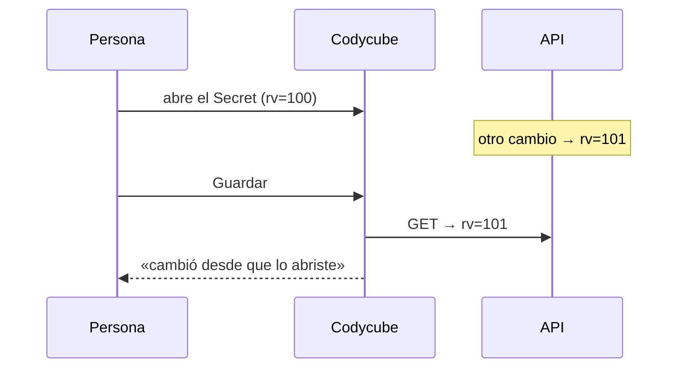

# 🔐 Edición con Control de Concurrencia

Cuando dos personas (o una persona y un controlador) cambian el mismo objeto, la última escritura gana. Kubernetes ofrece concurrencia optimista: cada objeto tiene `metadata.resourceVersion` y un `PUT` con una versión antigua responde **409 Conflict**.

## `editObject`

```ts
async function editObject(client, ref, resourceVersion, change) {
  const current = await client.json(path)                       // 1. leer
  if (current.metadata.resourceVersion !== resourceVersion)      // 2. ¿cambió desde que lo abriste?
    throw new Error(`${ref.name} cambió en el clúster desde que lo abriste. Recarga y vuelve a aplicar tu cambio.`)
  change(current)                                                // 3. aplicar solo tu cambio
  return client.json(path, { method: 'PUT', body: current })     // 4. guardar con esa versión
  // 409 → «cambió en el clúster mientras guardabas»
}
```



La comprobación del paso 2 detecta el caso más común con un mensaje claro; el `PUT` con `resourceVersion` del paso 4 cubre la carrera entre la lectura y la escritura.

## Dónde se usa

| Acción | Versión que se compara |
|---|---|
| Datos de ConfigMap y Secret | La del objeto cuando se abrió el editor |
| Etiquetas y anotaciones | La del panel de detalles |
| Taints | La del nodo mostrado |
| Editar YAML | La que va dentro del propio YAML |

## Lo que no se usa así

- **Aplicar YAML** es server-side apply con `force`: toma posesión de los campos que indiques. Es lo esperado al aplicar manifiestos; para eso existe **Simular**.
- **Escalar, reiniciar, pausar, cambiar imagen** son parches sobre campos concretos: no pisan el resto del objeto.
