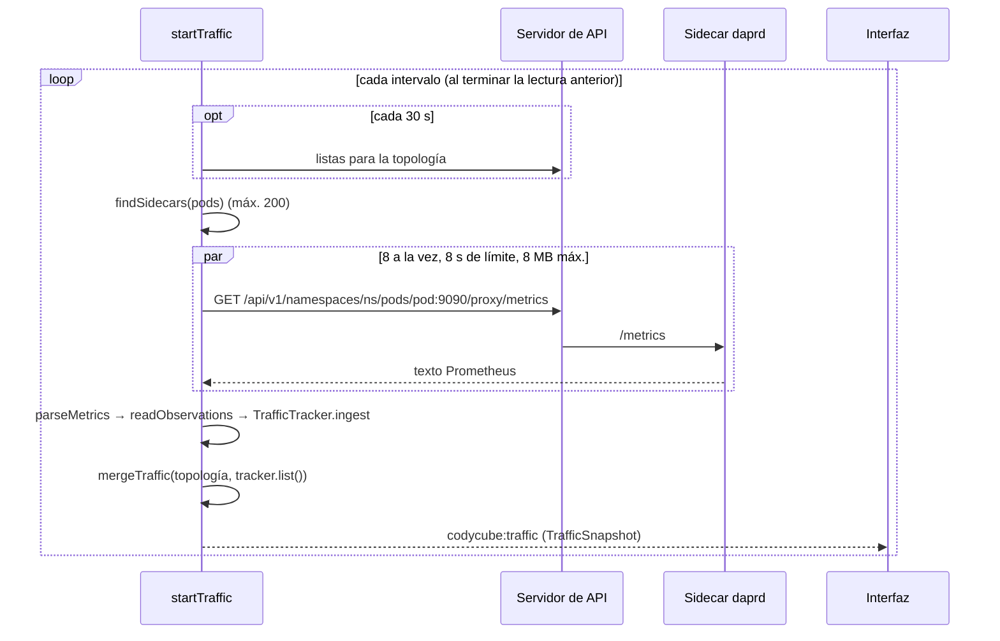

# 📈 Tráfico desde Dapr

Código: `src/main/traffic.ts` (`startTraffic`, `readObservations`, `TrafficTracker`, `mergeTraffic`) y `src/main/prometheus.ts`.

## Ciclo de lectura

- Un sidecar es un pod con un contenedor `daprd` (normal o init nativo). El puerto sale de `dapr.io/metrics-port` (9090 por defecto). Con `dapr.io/enable-metrics: "false"` cuenta como no leído y se dice por qué.
- **No hace falta Prometheus** ni abrir puertos: basta el permiso `get` sobre `pods/proxy`. Funciona en modo solo lectura.

## Métricas que se leen (Dapr 1.19)

| Métrica | Conexión | Resultado |
|---|---|---|
| `dapr_runtime_service_invocation_res_recv_total` | app → `src_app_id` (quien responde) | `HTTP 200`, `HTTP 503`, `gRPC 0`… |
| `dapr_runtime_service_invocation_res_recv_latency_ms_bucket` | igual | Histograma de latencia |
| `dapr_http_server_request_count` en `/v1.0/invoke/<app>/method/…` | app → destino | Los 5xx que no tienen respuesta = **No entregada** |
| `dapr_runtime_service_invocation_req_sent_total` | app → `dst_app_id` | Sin respuesta (apps gRPC con el destino caído) |
| `dapr_component_pubsub_egress_count` / `_latencies_bucket` | app → tema | Publicado / Publicación fallida |
| `dapr_component_pubsub_ingress_count` / `_latencies_bucket` | tema → app | Procesado / Reintento / Descartado |
| `dapr_component_{state,output_binding,input_binding,secret,configuration}_count` | app ↔ componente | Por operación |

> [!note] Las «No entregadas»
> Con el destino caído, Dapr falla **antes** de enviar: no cuenta respuestas y apenas envíos. Lo único que lo delata es lo que la app recibió de su propio sidecar (`dapr_http_server_request_count` con 5xx). Se resta lo que sí tuvo respuesta de error y el resto se marca como no entregado. Requiere que la app hable HTTP con su sidecar y que `increasedCardinality` no esté desactivado.

## De contadores a tasas

Los contadores son acumulados. `TrafficTracker` guarda la lectura anterior **por pod y por serie**:

1. `counterDelta(antes, ahora)`: si el valor bajó, el sidecar se reinició y el valor nuevo es lo acumulado desde entonces (como `rate()` de Prometheus).
2. Un pod que desaparece no resta: sus deltas simplemente dejan de sumarse.
3. Un pod que ya se conocía y presenta una serie nueva: esa serie empezó en cero, así no se pierde el primer error.
4. Cada conexión guarda hasta **60 lecturas** con sus resultados y buckets.

| Valor | Ventana |
|---|---|
| Tasa, % de error, desglose | Últimos **30 s** |
| p50 / p95 | Últimos **60 s**, interpolando dentro del bucket como `histogram_quantile` |
| Serie histórica (sparkline) | Hasta 60 lecturas |

La primera lectura solo fija la base (`warmingUp`): con una sola muestra no hay tasa.

## Unión con lo declarado

`mergeTraffic` coloca cada conexión medida sobre los nodos de la topología (por `app-id`), crea el tema si no había `Subscription` declarativa y marca la arista como `observed`. Una conexión vista **sigue listada aunque deje de tener tráfico**: el diagrama no parpadea.
