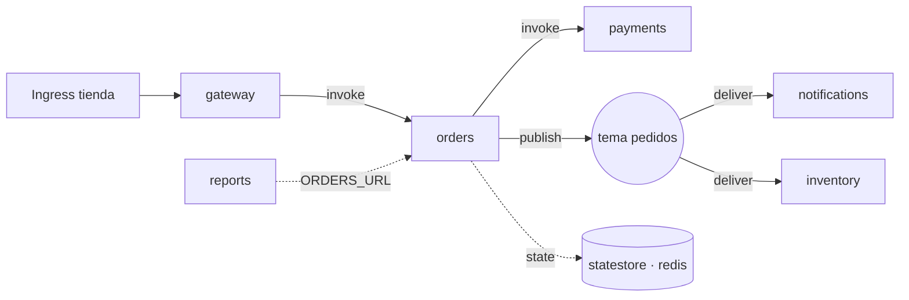

# 🧫 Clúster Desechable

Todas las pruebas de extremo a extremo y las capturas usan un k3s en Docker llamado **`codycube-test`**.

## Crear

```bash
docker run -d --name codycube-test --privileged -p 127.0.0.1:16443:6443 \
  --tmpfs /run --tmpfs /var/run rancher/k3s:latest server --disable traefik \
  --tls-san 127.0.0.1 --write-kubeconfig-mode 644

docker exec codycube-test cat /etc/rancher/k3s/k3s.yaml \
  | sed 's#https://127.0.0.1:6443#https://127.0.0.1:16443#; s/: default$/: codycube-test/' > /tmp/test.yaml
export KUBECONFIG=/tmp/test.yaml

kubectl apply -f tests/fixtures.yaml
printf 'apiVersion: ejemplo.dev/v1\nkind: Gadget\nmetadata: { name: rojo, namespace: demo }\nspec: { color: rojo }\n' | kubectl apply -f -
```

El puerto se publica solo en `127.0.0.1`. El `sed` renombra el contexto a `codycube-test`, que es lo que exigen las pruebas.

## Dapr y la demo

```bash
helm install dapr dapr --repo https://dapr.github.io/helm-charts/ -n dapr-system --create-namespace --wait
kubectl apply -f tests/dapr-demo.yaml
```

`tests/dapr-demo.yaml` crea el namespace `tienda`:



- Cinco apps en Python con sidecar de Dapr que generan tráfico continuo; `payments` responde 500 en un 10 % de las llamadas a propósito.
- `reports` no usa Dapr: solo declara la URL de `orders` en una variable (dependencia declarada).
- Redis como broker y almacén de estado.

## Borrar

```bash
docker rm -f codycube-test
docker rmi rancher/k3s:latest   # opcional
```
